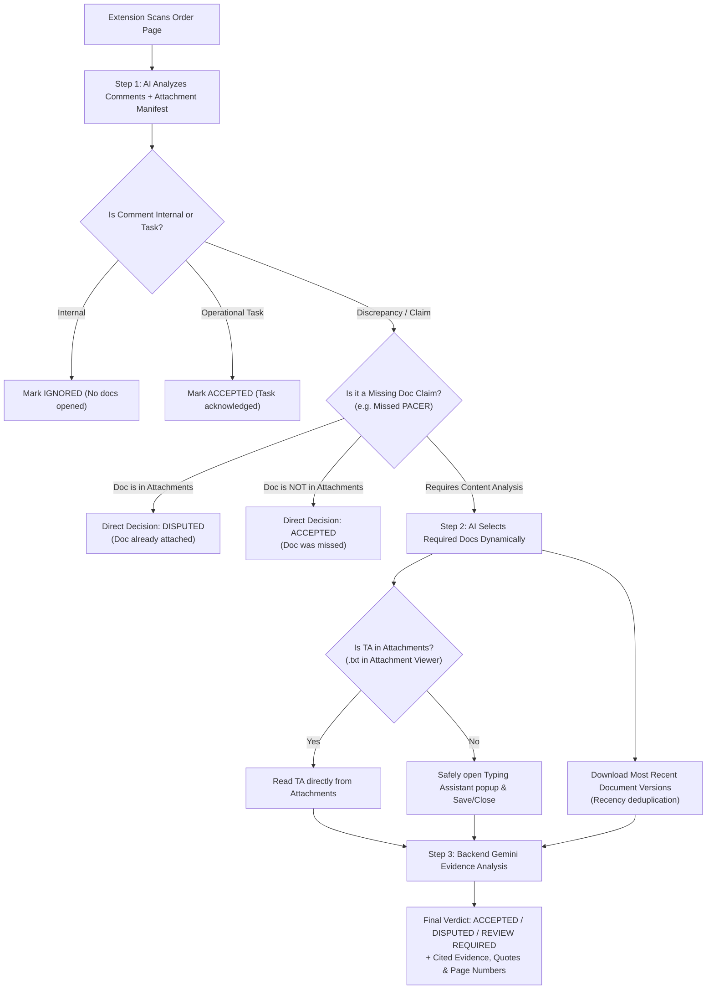

# SearchFix AI (v2.0.0)

SearchFix AI is an automated, evidence-based title examination review assistant for DataTrace. It pairs a Manifest V3 Chrome Extension with a high-performance Node.js / Google Gemini backend to evaluate customer order comments, identify claimed title discrepancies, dynamically determine and inspect required supporting documents, and produce cited, evidence-backed decisions (`ACCEPTED`, `DISPUTED`, or `REVIEW_REQUIRED`).

---

## 📁 Project Structure & Folder Roles

```
SearchFix/
├── extension/          # Manifest V3 Chrome Extension (Frontend)
├── src/                # Express & Google Gemini AI Backend
│   ├── config/         # Model fallbacks, runtime config, and document types
│   ├── controllers/    # API controllers for comment & document analysis
│   ├── prompts/        # Global Document Knowledge Base and AI system prompts
│   ├── routes/         # Express REST API endpoints
│   ├── schemas/        # Zod validation schemas for requests, responses & evidence
│   ├── services/       # AI classification, document analysis, evidence & decision engines
│   └── utils/          # Normalization, validation, and error helpers
├── tests/              # Comprehensive test suite (unit, integration, browser mocks)
├── config/             # Gemini API rate limits and model parameters
├── data/               # Ephemeral runtime cache and active analysis sessions
├── scripts/            # Build, setup, and backend configuration scripts
├── package.json        # Dependencies and test runner scripts
└── README.md           # Project documentation
```

### Folder Responsibilities:
* **`extension/`**: Contains the unpacked Chrome Extension. Handles read-only scanning of the DataTrace order queue, reading comments, scanning available attachments manifests, fetching document chunks, and rendering the live side panel UI.
* **`src/`**: The core AI analysis service.
  * **`src/prompts/documentKnowledge.js`**: Houses the **Global Document Knowledge Base** (the standardized ontology of all 20 title examination document types).
  * **`src/services/issueClassification.service.js`**: Selects the active client comment, identifies author role (Internal vs. Client), and classifies issues.
  * **`src/services/documentSelection.service.js`**: Dynamically chooses required evidence documents based on the claim and global document knowledge (eliminating hardcoded mapping tables).
  * **`src/services/documentAnalysis.service.js`**: Handles deep PDF and Word document inspection, OCR text parsing, and factual finding extraction.
  * **`src/services/decision.service.js`**: Synthesizes cited evidence against the client claim to produce the final verdict.
* **`tests/`**: Contains 110+ automated test suites testing every stage of the pipeline (comment selection, document support, PDF chunking, TA lifecycle, key safety, and API resilience).
* **`scripts/`**: Automation scripts to configure backend host URLs (`configure-backend.mjs`) and hash keys.

---

## 🧠 Dynamic Document Selection & Global Document Knowledge

Previous versions used static, hardcoded issue-to-document lookup tables. In production, title orders vary widely, and filenames or document types in county records are non-standard.

SearchFix 2.0 replaces hardcoded mappings with **AI-Driven Dynamic Selection** guided by a comprehensive **Global Document Knowledge Base**:

### The 20 Standardized Title Examination Document Types:
1. **`TA` (Typing Assistant)**: Raw draft / rough notes prepared by the typing team (`.txt` format).
2. **`TYPED_REPORT`**: The standardized, finalized Title Search Report created from TA data.
3. **`SEARCH_PACKAGE`**: Scanned bundle of official recorded instruments (Deeds, Mortgages, Releases, Assignments, etc.).
4. **`TAX`**: Municipal/County tax overview, tax bills, and commercial tax certificates (e.g., TaxSource).
5. **`PA`**: County Property Assessor card (PRC / Beacon / Schneider) with physical specs and valuations.
6. **`THR`**: Transaction History Report (DataTree / TitleFlex) with historical title transfer chains.
7. **`INDEX`**: County Clerk / Recorder index sheets and Title Plant name runs (TitleVision / DataSource).
8. **`ATTORNEY_OPINION`**: Formal Attorney Title Opinion (ATO) / Title Certification signed by a licensed attorney.
9. **`LEGAL_DESCRIPTION`**: Standalone Exhibit A boundary description (metes-and-bounds or platted lot/block).
10. **`VENDOR_MANAGEMENT`**: Client order instructions and requirements (Doma request forms, custom codes like LN1070).
11. **`LIEN`**: Municipal/County court searches for civil judgments, lawsuits, small claims, and tax warrants (Doxpop, Odyssey).
12. **`PACER`**: Federal bankruptcy court search reports (Chapter 7, 11, 13).
13. **`PATRIOT`**: US Treasury OFAC Patriot Act anti-terrorism and sanctions search reports.
14. **`MAP`**: Visual GIS parcel maps, tax maps, and recorded subdivision plat maps.
15. **`CHECKLIST`**: Standard "No Open Mortgage Checklist" and marked-up search indexes.
16. **`PROPERTY_REPORT`**: Title bring-down / date-down update reports (e.g., Vylla Update Report).
17. **`HOA_DOCUMENT`**: Homeowners Association declarations, bylaws, or CC&R restrictions.
18. **`LIEN_REGISTRY`**: Dedicated state/county lien registry search records.
19. **`COVER_SHEET`**: Abstractor search cover notes and title summary sheets.
20. **`COST_WORKSHEET`**: Internal abstractor search fee and invoice worksheets (DTNP).

---

## ⚡ Core Workflow & Key Logic Enhancements



### Key Logic Features:
1. **Attachment-First TA Reading**:
   * TA is checked in the order's attachments first (in `.txt` format).
   * The extension **only** navigates to the external Typing Assistant tool link if the TA is **not attached**, minimizing risk and popup interactions.
2. **Recency & Deduplication Rule**:
   * When multiple versions of a search package or report exist, SearchFix automatically selects the **most recent version** based on upload timestamps and date stamps in filenames.
3. **Missing Attachment Claim Verification**:
   * For client comments claiming missed files (*"Missed to attach PACER"*, *"Tax bill missing"*), the system verifies the attachment manifest directly. If attached, it disputes the claim; if absent, it accepts the error.
4. **Resilient Matching**:
   * Uses contextual understanding rather than rigid exact string matching to locate documents despite non-standard naming across counties.

---

## 🚀 Setup & Local Execution

### 1. Run the Backend
```bash
# Install dependencies
npm install

# Start development server
npm run dev

# Run all automated tests
npm test
```

### 2. Load the Chrome Extension
1. Open Chrome and navigate to `chrome://extensions`.
2. Enable **Developer mode** (top-right toggle).
3. Click **Load unpacked** and select the `SearchFix/extension` directory.
4. Open the DataTrace task queue, open the SearchFix side panel, and click **Scan the page**.
